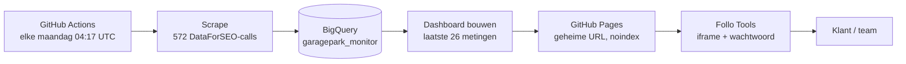

# GaragePark · Lokale Search & AI monitor

Wekelijkse meting van de lokale vindbaarheid van GaragePark in 22 vestigingsplaatsen: Google Search (mobiel, top 20, local pack, SERP features), AI Overviews, Google AI Mode en optioneel ChatGPT. Alles draait in GitHub Actions; de data gaat naar BigQuery en het dashboard ververst zichzelf. Na de eenmalige setup hoef je niets meer handmatig te doen.

## Hoe het werkt



Elke maandag gebeurt automatisch:

1. **Scrapen**: per plaats × keyword een Google-zoekresultaat (met AI Overview) en een AI Mode-antwoord via de goedkopere Standard Queue van DataForSEO. Taken die na 45 minuten nog niet klaar zijn, worden alsnog Live opgehaald. Faalt meer dan 10%, dan stopt de run en blijft de vorige week staan.
2. **Naar BigQuery**: de ruwe JSON wordt omgezet naar zeven tabellen. Elke week vervangt alleen zijn eigen datum-partitie, dus een week opnieuw draaien is veilig.
3. **Dashboard bouwen**: een nieuwe `index.html` uit BigQuery, met de data erin gebakken. De laatste 2 metingen gaan volledig mee (antwoorden, bronnen, SERP-details), oudere compact (posities, mentions, citaties) zodat streaks en trends groeien en de pagina licht blijft.
4. **Publiceren**: GitHub Pages vervangt de vorige versie op **dezelfde URL**. De iframe in Follo Tools wijst naar die URL en laat dus automatisch de nieuwste week zien.

**Publieke repository.** De code staat openbaar, de data niet. Ruwe metingen gaan direct naar BigQuery en worden niet als bestand bij de run bewaard; het Pages-pakket wordt na het publiceren meteen verwijderd; logs tonen geen saldo of klantdata. De eerste meting staat versleuteld in `data/backfill/` en is alleen met secret `BACKFILL_KEY` te openen.

**Beveiliging van de URL.** Het dashboard staat niet op de voorkant van de Pages-site, maar op een geheim pad dat je zelf kiest: `https://tomharteveld.github.io/garagepark-monitor/<geheim-pad>/`. De voorkant toont een lege pagina, `robots.txt` blokkeert alle crawlers en elke pagina heeft `noindex`. De klant krijgt alleen de Follo Tools-link met wachtwoord te zien.

## Wat zit waar

| Pad | Inhoud |
|---|---|
| `config/monitor.yaml` | Plaatsen (DataForSEO location codes), keywords + volume, prompt, device, merken voor mention-detectie, engines aan of uit |
| `src/gpmon/scrape.py` | DataForSEO-calls, schrijft `data/raw/run_JJJJ-MM-DD.jsonl.gz` |
| `src/gpmon/transform.py` | Ruwe JSON naar tabellen |
| `src/gpmon/bq.py` | BigQuery-schema's, laden per week, historie ophalen |
| `src/gpmon/dashboard.py` | Bouwt `site/<geheim-pad>/index.html`, `robots.txt` en een lege voorpagina |
| `dashboard/` | HTML-template, kaart van Nederland, Follo-logo's |
| `.github/workflows/weekly.yml` | De wekelijkse run en de handmatige modi |
| `.github/workflows/tests.yml` | Tests bij elke push |
| `scripts/setup_gcp.sh` | Eenmalige Google Cloud-setup |
| `tests/` | Offline tests met een fixture van Breda en Amsterdam |

# Stappenplan

Reken op ongeveer 30 minuten. Doe de stappen op volgorde.

## Stap 1 · Repository

De code staat in `tomharteveld/garagepark-monitor`. De ruwe data (`data/raw/*.jsonl.gz`) staat in `.gitignore`; alleen de versleutelde eerste meting in `data/backfill/` gaat mee.

## Stap 2 · Google Cloud koppelen (keyless)

1. Open [Cloud Shell](https://shell.cloud.google.com) in het GCP-project waar de data moet komen.
2. Haal de code binnen en draai het script:

```bash
git clone https://github.com/tomharteveld/garagepark-monitor.git && cd garagepark-monitor
```

```bash
PROJECT_ID=folloagency GITHUB_REPO=tomharteveld/garagepark-monitor bash scripts/setup_gcp.sh
```

Het script:
* zet de BigQuery- en IAM-API's aan;
* maakt dataset `garagepark_monitor` in de EU (bestaat al in `folloagency`, wordt overgeslagen);
* maakt service account `garagepark-monitor` met alleen *BigQuery Job User* op het project en *Data Editor* op deze ene dataset;
* maakt een Workload Identity-koppeling die **alleen** deze GitHub-repository vertrouwt. Er wordt geen sleutel aangemaakt.

Aan het eind print het vijf waarden. Houd die bij de hand voor stap 4.

> Mag je in jullie GCP-organisatie geen Workload Identity aanmaken? Maak dan een JSON-sleutel voor het service account, zet die in stap 4 als secret `GCP_SA_KEY` en laat `GCP_WIF_PROVIDER` leeg. De workflow valt dan automatisch terug op de sleutel.

## Stap 3 · Geheim pad kiezen

Maak een willekeurige string, bijvoorbeeld in je terminal:

```bash
openssl rand -hex 8
# voorbeeld uitkomst: 7c1f9a04be2d6e53
```

Dit wordt het pad van het dashboard. Bewaar hem, je hebt hem in stap 4 en stap 8 nodig.

## Stap 4 · GitHub instellen

In de repository: *Settings → Secrets and variables → Actions*.

**Tabblad Secrets** (New repository secret):

| Naam | Waarde |
|---|---|
| `DATAFORSEO_LOGIN` | DataForSEO API-login |
| `DATAFORSEO_PASSWORD` | DataForSEO API-wachtwoord |
| `DASHBOARD_PATH` | het geheime pad uit stap 3, bijvoorbeeld `7c1f9a04be2d6e53` |
| `BACKFILL_KEY` | de sleutel van de versleutelde eerste meting (krijg je van Claude) |

**Tabblad Variables** (New repository variable), waarden uit stap 2:

| Naam | Waarde |
|---|---|
| `GCP_PROJECT_ID` | `folloagency` |
| `GCP_WIF_PROVIDER` | `projects/…/providers/github-actions` |
| `GCP_SERVICE_ACCOUNT` | `garagepark-monitor@<project>.iam.gserviceaccount.com` |
| `BQ_DATASET` | `garagepark_monitor` |
| `BQ_LOCATION` | `EU` |

Daarna: *Settings → Pages → Build and deployment → Source* op **GitHub Actions** zetten.

## Stap 5 · Smoke test

*Actions → GaragePark weekly monitor → Run workflow → mode: **smoke** → Run workflow.*

Dit doet 6 echte DataForSEO-calls (een paar cent), bouwt een testdashboard en gooit dat weer weg. Er gaat niets naar BigQuery en er wordt niets gepubliceerd. Groen betekent: login, netwerk, scraper en dashboard werken.

## Stap 6 · De meting van 2 november inladen en publiceren

*Actions → GaragePark weekly monitor → Run workflow → mode: **backfill**.*

De workflow ontsleutelt `data/backfill/run_2026-11-02.jsonl.gz.enc` met `BACKFILL_KEY`, laadt hem in BigQuery en bouwt en publiceert direct het dashboard. Stap 7 is daarmee meteen gedaan.

## Stap 7 · Eerste publicatie

Na de backfill-run staat het dashboard op:

```
https://tomharteveld.github.io/garagepark-monitor/<DASHBOARD_PATH>/
```

Open die URL één keer zelf om te controleren. De voorpagina zonder het pad laat bewust niets zien.

## Stap 8 · Koppelen in Follo Tools

In tools.folloagency.com → *New share link*:

* **Name**: GaragePark lokale monitor
* **Content type**: **Iframe embed**
* **Colleague visibility**: naar keuze
* **Iframe embed code**:

```html
<iframe src="https://tomharteveld.github.io/garagepark-monitor/<DASHBOARD_PATH>/" style="width:100%;height:100vh;border:0"></iframe>
```

* **Client access**: Password protected

Deel daarna alleen de Follo-link en het wachtwoord met de klant. Dit hoef je maar één keer te doen: vanaf nu ververst de inhoud elke maandag vanzelf.

## Klaar

Vanaf de volgende maandag draait alles automatisch. In de Actions-tab zie je elke week een run; bij een fout stuurt GitHub je een mail.

GitHub zet geplande workflows op publieke repositories normaal uit na 60 dagen zonder commits. De job `keepalive` zet de workflow aan het eind van elke run opnieuw aan, waardoor die teller steeds reset. Je hoeft daar niets voor te doen.

# Dagelijks gebruik

## Modi van de workflow

| Modus | Wat het doet | Wanneer |
|---|---|---|
| automatisch, maandag | scrape → BigQuery → dashboard → Pages | elke week |
| `full` | idem, handmatig | extra meting, of herstel na een storing |
| `gbp` | alleen bedrijfsprofielen ophalen, dan dashboard | profieldata verversen zonder zoekresultaten |
| `rebuild` | alleen dashboard uit BigQuery | na een wijziging in template of config |
| `backfill` | versleutelde runs uit `data/backfill/` inladen, dan dashboard | eenmalig, of om een oude meting terug te zetten |
| `smoke` | 6 calls, niets wegschrijven | na een wijziging in de scraper |

## Iets aanpassen

* **Dag of tijd**: de `cron` in `.github/workflows/weekly.yml` (in UTC). GitHub start geplande runs bij drukte soms een paar minuten later.
* **Keyword toevoegen**: één regel onder `keywords:` in `config/monitor.yaml`, met het zoekvolume.
* **Plaats toevoegen**: zoek de location code op via DataForSEO (`/v3/serp/google/locations/nl`, type *City*), zet hem onder `cities:` en voeg de coördinaten toe aan `GEO` in `dashboard/template.html` zodat hij op de kaart staat.
* **Concurrent toevoegen voor mention-detectie**: onder `brands:` met domein en zoekpatroon.
* **Geheim pad vervangen** (bijvoorbeeld als de link is uitgelekt): nieuw pad in secret `DASHBOARD_PATH`, workflow draaien met `rebuild`, iframe in Follo Tools aanpassen. Het oude pad verdwijnt bij die deploy.

Na een wijziging: commit, push en draai `rebuild` (alleen weergave) of wacht op maandag.

## Bedrijfsprofielen

Naast de zoekresultaten haalt de job `gbp` elke week alle Google Bedrijfsprofielen van GaragePark op (gevonden op domein en telefoonnummer, nu 59), plus per park de vijf concurrenten die Google toont onder "Mensen zoeken ook". Per profiel: profielgegevens, reviews (eigen parken tot 200, concurrenten de laatste 40) en posts. Dat komt in de tabellen `gbp_profiles`, `gbp_competitors`, `gbp_reviews`, `gbp_posts` en `gbp_run_log`.

Het tabblad Bedrijfsprofielen berekent daaruit (in `src/gpmon/gbp_view.py`) de profielscore, de onderwerpen in reviews en een actielijst per park met impact en moeite. Afvinken in die lijst wordt per browser onthouden.

Alleen de bedrijfsprofielen opnieuw ophalen: Run workflow met mode `gbp`. Instellingen staan onder `gbp:` in `config/monitor.yaml`. Prestaties uit Bedrijfsprofielmanager (weergaven, zoektermen, gesprekken, routes) vragen beheerderstoegang tot de profielen en volgen later.

## Live of Standard Queue

`scrape.queue` in `config/monitor.yaml` staat op `standard`: ongeveer 70% goedkoper, de resultaten komen meestal binnen 5 tot 20 minuten. Zet hem op `live` als een run snel klaar moet zijn. Voor één handmatige run kan het ook met `python -m gpmon.scrape --queue live`.

## ChatGPT aanzetten

Zet in `config/monitor.yaml` onder `engines` `chatgpt: true`. De scraper stuurt dan dezelfde prompts naar ChatGPT (Nederland, webzoeken aan), de antwoorden komen in dezelfde tabellen met `engine = 'cgpt'` en het ChatGPT-tabblad in het dashboard vult zich vanzelf. ChatGPT-calls zijn duurder en duren tot 2 minuten per stuk; reken op 15 tot 25 minuten extra looptijd.

# BigQuery

Alle tabellen zijn gepartitioneerd op `run_date`.

| Tabel | Eén rij per | Belangrijkste velden |
|---|---|---|
| `serp_summary` | plaats × keyword × week | `own_position`, `own_url`, `in_local_pack`, `features`, `has_ai_overview` |
| `serp_results` | organisch resultaat (top 20) | `rank_group`, `domain`, `url`, `is_own` |
| `local_pack` | bedrijf in het kaartblok | `position`, `title`, `rating`, `is_own` |
| `ai_answers` | AI-antwoord (`aio`, `aim`, `cgpt`) | `markdown`, `mentioned`, `cited_web`, `cited_gbp`, `brands_mentioned` |
| `ai_citations` | bron in een AI-antwoord | `domain`, `url`, `is_gbp`, `brand`, `kind` |
| `run_log` | API-call | `status`, `error`, `cost` |
| `raw_tasks` | volledige DataForSEO-response (JSON) | om later nieuwe inzichten af te leiden zonder opnieuw te scrapen |

```sql
-- Top 10-dekking per plaats per week
SELECT run_date, city, ROUND(AVG(IF(own_position <= 10, 1, 0)) * 100, 1) AS top10_pct
FROM `PROJECT.garagepark_monitor.serp_summary`
GROUP BY 1, 2 ORDER BY 1 DESC, 3 DESC;

-- Mention share per merk in AI Mode, laatste meting
SELECT brand, COUNT(*) AS antwoorden
FROM `PROJECT.garagepark_monitor.ai_answers`, UNNEST(brands_mentioned) AS brand
WHERE engine = 'aim' AND run_date = (SELECT MAX(run_date) FROM `PROJECT.garagepark_monitor.ai_answers`)
GROUP BY 1 ORDER BY 2 DESC;
```

De tabellen zijn ook direct te koppelen aan Looker Studio of FolloEngine.

# Kosten per week

| Onderdeel | Ongeveer |
|---|---|
| DataForSEO, Standard Queue (286 SERPs + 286 AI Mode) | ca. $0,65 (Live: $2,15) |
| ChatGPT (als aan) | zie de DataForSEO-prijslijst voor LLM Scraper |
| BigQuery | ca. 45 MB opslag per week, ruim binnen de gratis laag |
| GitHub Actions | ca. 20 tot 30 minuten per week (wachten op de queue) |
| GitHub Pages | gratis |

# Als iets misgaat

| Melding | Oorzaak | Oplossing |
|---|---|---|
| `Error rate too high` | DataForSEO-storing, niets weggeschreven | later `full` opnieuw draaien |
| `Missing environment variable` | secret of variable ontbreekt | stap 4 nalopen |
| Auth-fout bij Google | repository-naam in setup-script klopt niet | script opnieuw draaien met de exacte `owner/repo` |
| `No runs in BigQuery yet` | stap 6 overgeslagen | `backfill` of `full` draaien |
| `Secret BACKFILL_KEY ontbreekt` | secret niet gezet | stap 4 |
| Iframe in Follo Tools blijft leeg | verkeerde URL of pad zonder `/` aan het eind | URL uit stap 7 eerst los openen, dan in de iframe plakken |
| Dashboard toont nog de oude week | cache van Pages | paar minuten wachten, dan verversen |

# Lokaal draaien

```bash
pip install -r requirements.txt
export PYTHONPATH=src
python -m gpmon.dashboard --source local --path test   # dashboard uit data/raw, geen cloud nodig → site/test/index.html
python -m pytest -q tests                              # offline tests
```
